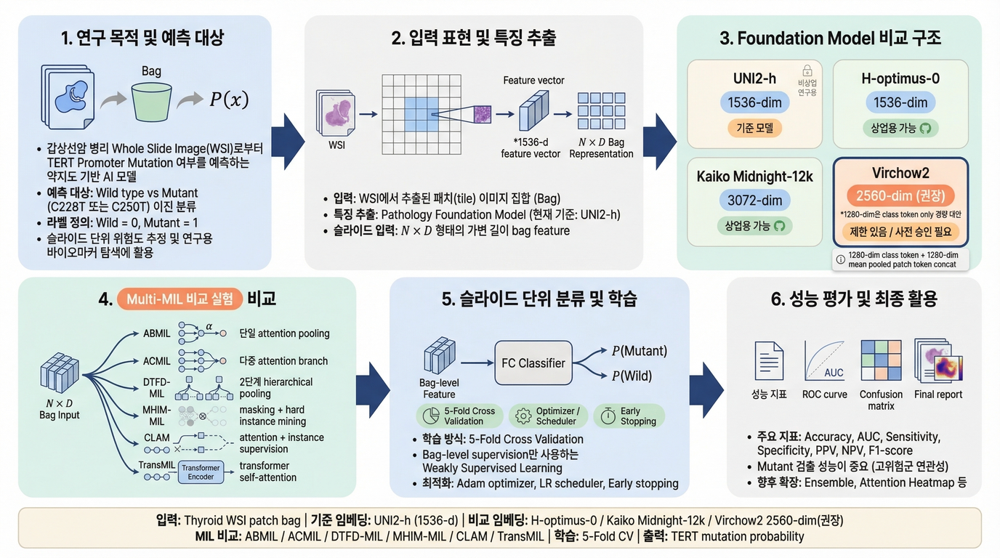

# Thyroid TERT Promoter Mutation Prediction

<p align="center">
  
</p>

갑상선 H&E WSI의 patch feature에서 **TERT promoter mutation**을 weakly-supervised MIL로 예측하는 파이프라인. patch-level label 없이 **slide-level label만** 사용하고, foundation model로 미리 추출한 patch embedding(`.npy`)에서 학습을 시작한다. 구현은 `src/`, 실행 도구는 `scripts/`. 대상 task는 **2-class**(Wild vs Mutant)와 **3-class**(Wild / C228T / C250T), 데이터는 201 WSI다.

파이프라인은 3개 요소로 나뉘고, 각 요소를 설정으로 골라 조합한다.

| 요소 | 지정 방법 | 지원 옵션 |
|---|---|---|
| A. patch encoder | CV split 파일 (`CV_SPLIT_FILE`) | UNI2-H (1536) · H-Optimus-0 (1536) · H-Optimus-1 (1536) · Hibou-L (1024) · Virchow2 (2560) |
| B. aggregation | `--model_type` (기본 `abmil`) | `abmil` · `transmil` · `acmil` · `dtfd` · `mhim` · `clam` |
| C. task | `--num_classes` (기본 2) | 2 (Wild vs Mutant) · 3 (Wild / C228T / C250T) |

모델·인코더 선택은 §5, 출력·실험 관리는 §6, 학습 편의 기능은 §7 참조. 아래는 환경 → 데이터 준비 → split → 학습·평가 순서다.

## 1. 환경

```bash
pip install -r requirements.txt     # torch · timm · transformers · openslide-python · mlflow · nystrom-attention
```

- TransMIL은 `nystrom-attention`이 필요하다 (없으면 `train.sh`가 시작 전에 알려 준다).
- H-Optimus-1 · Hibou-L · Virchow2는 gated 모델이다 → HuggingFace 접근 승인 + 토큰.

## 2. 데이터셋 준비

slide마다 embedding `.npy` 하나와 좌표 `.json` 하나가 필요하다. 클래스별 하위 폴더로 나뉜다.

```text
{dataset_root}/<embedding_dir>/
├── Wild/   npy/<slide_id>.npy   json/<slide_id>.json
├── C228T/  npy/…                json/…
└── C250T/  npy/…                json/…
```

| 파일 | 내용 | 형식 |
|---|---|---|
| `npy/<slide_id>.npy` | 패치 N개의 embedding | `(N, D)` float32, D = 인코더 차원 |
| `json/<slide_id>.json` | `slide_id`, `num_tiles`, `patch_coords[{name, x, y}]` | 패치 좌표 (heatmap용) |

`N`(패치 수)은 slide마다 다르다. bag은 가변 길이이며 `batch_size=1`로 처리한다.

**데이터 규모.** 201 WSI (`Wild 113` / `C228T 69` / `C250T 19`). 패치는 40x `512×512` 4,273,287장과 20x `224×224` 5,259,005장을 보유한다. 라벨은 SVS 파일명이 아닌 별도 표로 관리하며, 실제 slide ID가 들어 있는 파일(라벨 표, CV split JSON)은 이 저장소에 포함하지 않는다.

**임베딩 추출.** 추출기는 완료된 `.npy`를 건너뛰는 resume 구조라 중단 후 같은 명령으로 이어서 진행된다.

```bash
cd src/data/uni2-h      && bash run_embedding.sh
cd src/data/h-optimus-0 && bash run.sh           # DDP
cd src/data/h-optimus-1 && bash run.sh           # DDP (HF 토큰)
cd src/data/virchow2    && python check_env.py && bash run.sh && bash monitor.sh -w
```

## 3. CV split과 인코더 메타데이터

학습은 **CV split JSON 하나**로 데이터를 지정한다. fold마다 train / val / test의 `.npy` 경로 목록이 들어 있다 (형식: `config/cv_splits_tert_example.json`).

```json
{ "n_splits": 5, "seed": 42, "encoder": "Hibou-L", "embed_dim": 1024,
  "folds": [ { "fold": 1, "train_wsis": ["…/C228T/npy/a.npy"], "val_wsis": ["…"], "test_wsis": ["…"] } ] }
```

| Encoder | 패치 | CV split | embed_dim | 학습 버전 |
|---|---|---|---:|---|
| UNI2-H | 40x `512×512` | `cv_splits_tert_5fold_seed42.json` | 1536 | `v0.1.x ~ v0.5.x` |
| H-Optimus-0 | 40x → `224×224` | `…_hoptimus.json` · `…_hoptimus_3class.json` | 1536 | `v0.6.x ~ v0.15.x` |
| H-Optimus-1 | 40x `512×512` | `…_hoptimus1_40x_{2,3}class.json` | 1536 | `hoptimus1_v0.1.x ~ v0.6.x` |
| Hibou-L | 40x → `224×224` | `…_hibou_L_40x_{2,3}class.json` | 1024 | `hibou_v0.1.x ~ v0.5.x` |
| Virchow2 | 40x → `224×224` | `…_virchow2_40x_{2,3}class.json` | 2560 | 학습 대기 |

**고정 공유 split (paired 비교).** UNI2-H split의 fold 구성은 그대로 두고 **임베딩 경로만** 다른 인코더로 바꾼다. 모든 인코더가 같은 fold를 쓰므로 인코더 간 fold별 비교가 가능하다.

```bash
python src/data/create_cv_splits_hoptimus.py \
  --old_root {dataset_root}/embedding --new_root {dataset_root}/hibou_L_embeddings_40x \
  --output_json config/cv_splits_tert_5fold_seed42_hibou_L_40x_2class.json \
  --encoder Hibou-L --embed_dim 1024 --verify
bash scripts/make_virchow2_splits.sh        # Virchow2: 201장 완료·차원 2560 확인 후 생성
```

**인코더 메타데이터 흐름.** split JSON의 `encoder` / `embed_dim`이 학습 `--in_dim`, MLflow param·tag, Registry `embedding` 태그까지 그대로 전달된다. 인코더명을 하드코딩하지 않으므로 Hibou-L 모델이 UNI2-H로 잘못 등록되지 않는다.

## 4. 학습 / 평가

```bash
# ---- 학습 (5-fold CV → fold별 test) ----
cd src/training && bash train.sh                    # 상단 [1]~[10]에서 CV_SPLIT_FILE 하나만 주석 해제
GPU_ID=5 bash train.sh                              # GPU 지정 (nvidia-smi 번호 그대로)

# ---- 직접 실행 ----
python src/training/main.py \
  --cv_split_file config/cv_splits_tert_5fold_seed42_hibou_L_40x_2class.json \
  --model_save_dir outputs/thyroid_tert_hibou_vX.X.X \
  --model_type abmil --num_classes 2 --in_dim 1024 \
  --epochs 100 --lr 1e-4 --bag_size 500 --save_model --save_best_only --generate_plots

# ---- bag_size 스윕을 여러 GPU에 분배 ----
bash scripts/sweep.sh --gpus 5,6 --bags 200,400,800,1600 --model abmil --prefix thyroid_tert_v9.9
bash scripts/sweep_status.sh thyroid_tert_v9        # run별 AUC/F1 요약

# ---- MLflow Registry 등록 ----
python src/inference/register_model.py --model_save_dir outputs/thyroid_tert_model_vX.X.X
```

**Bag sampling.** train은 `bag_size`개 패치를 랜덤 샘플링하고, val·test는 **Full WSI**(전체 패치)로 평가한다.

**학습 설정.** Adam (`lr=1e-4`, `weight_decay=1e-4`), ReduceLROnPlateau (`patience=15`, `factor=0.5`), CrossEntropyLoss. early stopping은 validation **loss** 기준 (`patience=8`, `min_delta=0.001`).

**Threshold.** 2-class는 0.5 고정, 3-class는 argmax.

**split과 설정은 한 세트.** `CV_SPLIT_FILE`의 임베딩 계열과 `NUM_CLASSES`·`IN_DIM`이 어긋나면 조용히 잘못된 결과가 나오거나 shape 오류로 죽는다. `IN_DIM`은 `train.sh`가 split JSON의 `embed_dim`에서 자동으로 읽는다.

**스윕은 DDP가 아니라 run 분배.** MIL 학습은 GPU 1장·VRAM 2GB 수준이라 DDP로 쪼개도 이득이 없다. 독립적인 run을 GPU마다 하나씩 붙여 장수만큼 선형으로 줄인다.

### 실험 결과 (Results)

5-fold CV(seed 42 공유 split), test는 Full WSI. 각 행은 `bag_size` 스윕(스윕당 약 10 run) 중 **test AUC 최고 run**의 5-fold test 평균이다. AUC의 `±`는 fold 표준편차(결과 요약이 보존된 run만 표기).

**2-class (Wild vs Mutant)** — (**bold** = 열 최고)

| Method | run | AUC | F1 | Acc | Sens | Spec |
|---|---|---|---:|---:|---:|---:|
| **UNI2-H (1536)** | | | | | | |
| ABMIL | `v0.2.2` | 0.9699 ± 0.0217 | **0.9312** | **0.9404** | **0.9209** | 0.9557 |
| TransMIL | `v0.3.5` | 0.9585 | 0.8724 | 0.8910 | 0.8418 | 0.9285 |
| ACMIL | `v0.4.4` | 0.9667 | 0.9233 | 0.9356 | 0.8876 | **0.9739** |
| DTFD-MIL | `v0.5.3` | 0.9676 | 0.8885 | 0.9059 | 0.8536 | 0.9470 |
| **H-Optimus-0 (1536)** | | | | | | |
| ABMIL | `v0.6.0` | **0.9716** ± 0.0190 | 0.8997 | 0.9106 | 0.9098 | 0.9107 |
| TransMIL | `v0.7.7` | 0.9633 ± 0.0222 | 0.9034 | 0.9206 | 0.8542 | 0.9731 |
| ACMIL | `v0.8.0` | 0.9645 ± 0.0199 | 0.8982 | 0.9156 | 0.8536 | 0.9644 |
| DTFD-MIL | `v0.9.2` | 0.9709 ± 0.0108 | 0.9149 | 0.9306 | 0.8765 | 0.9735 |
| **H-Optimus-1 (1536)** | | | | | | |
| ABMIL | `hoptimus1_v0.1.9` | 0.9617 ± 0.0259 | 0.9026 | 0.9209 | 0.8542 | **0.9739** |
| TransMIL | `hoptimus1_v0.2.5` | 0.9688 ± 0.0174 | 0.8935 | 0.9055 | 0.8987 | 0.9107 |
| ACMIL | `hoptimus1_v0.3.3` | 0.9543 ± 0.0300 | 0.9058 | 0.9209 | 0.8647 | 0.9652 |
| DTFD-MIL | `hoptimus1_v0.4.5` | 0.9612 | 0.9026 | 0.9209 | 0.8542 | **0.9739** |
| MHIM-MIL | `hoptimus1_v0.5.6` | 0.9619 ± 0.0259 | 0.8941 | 0.9109 | 0.8647 | 0.9462 |
| CLAM | `hoptimus1_v0.6.6` | 0.9596 ± 0.0209 | 0.9039 | 0.9207 | 0.8654 | 0.9644 |
| **Hibou-L (1024)** | | | | | | |
| ABMIL | `hibou_v0.1.2` | 0.9594 ± 0.0257 | 0.8579 | 0.8759 | 0.8542 | 0.8937 |
| TransMIL | `hibou_v0.2.7` | 0.9614 ± 0.0186 | 0.8931 | 0.9105 | 0.8654 | 0.9470 |
| ACMIL | `hibou_v0.3.7` | 0.9609 ± 0.0224 | 0.8952 | 0.9107 | 0.8647 | 0.9470 |
| DTFD-MIL | `hibou_v0.4.7` | 0.9590 ± 0.0248 | 0.9078 | 0.9207 | 0.8876 | 0.9462 |
| MHIM-MIL | `hibou_v0.5.9` | 0.9613 ± 0.0198 | 0.8884 | 0.9057 | 0.8654 | 0.9375 |

**3-class (Wild / C228T / C250T)** — H-Optimus-0, argmax 예측

| Method | run | AUC | F1 | Acc | Sens | Spec |
|---|---|---|---:|---:|---:|---:|
| ABMIL | `v0.10.0` | 0.8731 ± 0.0482 | 0.5584 | 0.7215 | 0.5583 | 0.8487 |
| TransMIL | `v0.11.0` | **0.8894** ± 0.0456 | **0.6637** | **0.8409** | **0.6789** | **0.9144** |
| ACMIL | `v0.12.6` | 0.8787 ± 0.0488 | 0.5556 | 0.7909 | 0.5785 | 0.8843 |
| DTFD-MIL | `v0.13.2` | 0.8809 ± 0.0398 | 0.6025 | 0.7960 | 0.6047 | 0.8806 |
| MHIM-MIL | `v0.14.4` | 0.8871 ± 0.0238 | 0.5245 | 0.7761 | 0.5524 | 0.8567 |
| CLAM | `v0.15.1` | 0.8879 ± 0.0437 | 0.5917 | 0.8307 | 0.6191 | 0.9087 |

**해석 규약 — 위 표는 test 기준 선택이라 낙관적이다.** 같은 스윕에서 **validation AUC로 run을 고르고 test는 한 번만** 보도록 재집계하면 (결과 요약이 보존된 2-class 15개 스윕):

| Encoder | ABMIL | TransMIL | ACMIL | DTFD-MIL | MHIM-MIL | CLAM |
|---|---:|---:|---:|---:|---:|---:|
| H-Optimus-0 | 0.9716 | 0.9566 | 0.9408 | 0.9616 | — | — |
| H-Optimus-1 | 0.9607 | 0.9450 | 0.9268 | 0.9447 | 0.9400 | 0.9482 |
| Hibou-L | 0.9594 | 0.9602 | 0.9554 | 0.9210 | 0.9472 | — |

- test 기준 선택은 val 기준보다 평균 **+0.013 AUC** (최대 +0.038) 높게 나온다. 인코더 4종 best의 AUC 폭이 **0.0102**, fold 표준편차가 **약 0.019**이므로, 이 편향만으로 인코더 순위가 바뀔 수 있다.
- val 기준으로 보면 **ABMIL이 세 인코더 모두에서 가장 안정적**이다 (0.959~0.972). 집계기가 복잡할수록 선택 편향에 취약했다.
- test fold가 41장이라 1장 오분류가 accuracy 2.4%p다. 3-class는 C250T가 19장뿐이라 소수 클래스가 전체를 끌어내린다.
- 다음 인코더(Virchow2)부터는 val 기준 선택 · fold별 AUC + 95% CI · DeLong/bootstrap 유의성 검정으로 평가하고, CI가 기존 best와 겹치면 "개선 없음"으로 기록한다.

## 5. 모델 · 인코더 선택

**aggregation (`--model_type`)**

| 이름 | 방법 | 핵심 인자 | 논문 |
|---|---|---|---|
| `abmil` | gated attention MIL | `--embed_dim` `--attn_dim` `--num_fc_layers` `--dropout` | Ilse et al., ICML 2018 |
| `transmil` | Nyström attention + PPEG | `--transmil_num_heads` `--transmil_num_layers` `--transmil_num_landmarks` | Shao et al., NeurIPS 2021 |
| `acmil` | multi-branch attention + masking | `--acmil_n_token` `--acmil_n_masked_patch` `--acmil_mask_drop` | Zhang et al., ECCV 2024 |
| `dtfd` | pseudo-bag double-tier distillation | `--dtfd_n_pseudo_bags` | Zhang et al., CVPR 2022 |
| `mhim` | hard-instance masking + EMA teacher | `--mhim_mask_ratio` `--mhim_ema_decay` | Tang et al., ICCV 2023 |
| `clam` | CLAM-SB + instance clustering | `--clam_k_sample` | Lu et al., Nat. Biomed. Eng. 2021 |

**patch encoder**

| Encoder | HF 모델 | 차원 | 비고 |
|---|---|---:|---|
| UNI2-H | `MahmoodLab/UNI2-h` | 1536 | |
| H-Optimus-0 / 1 | `bioptimus/H-optimus-0` · `-1` | 1536 | 정규화 상수·출력 차원 동일 — 코드 차이는 모델 ID 한 줄 |
| Hibou-L | `histai/hibou-L` | 1024 | 전용 정규화값. 추출기는 [BRAF 저장소](https://github.com/rudjtr234/Thyroid_Mutation_Prediction_Model)의 `src/data/hibou/` |
| Virchow2 | `paige-ai/Virchow2` | 2560 | `concat(CLS, mean(patch tokens))`. register token 4개 제외(`out[:, 5:]`), `reg_tokens=4`·`SwiGLUPacked`·`SiLU` 필수 |

2560-dim까지 6개 MIL 모델 모두 **코드 수정 없이** `--in_dim`만 맞추면 학습된다.

## 6. 출력 레이아웃 · 실험 관리

```text
outputs/
  thyroid_tert_model_vX.X.X/        # UNI2-H / H-Optimus-0 계열
  thyroid_tert_hoptimus1_vX.X.X/    # H-Optimus-1 계열
  thyroid_tert_hibou_vX.X.X/        # Hibou-L 계열
  thyroid_tert_virchow2_vX.X.X/     # Virchow2 계열
    results_cv_summary_optimal.json # fold별 지표 + 평균·표준편차, ROC/PR 곡선 좌표
    cv_results_all_folds.html       # 요약 리포트
    checkpoints/                    # fold별 best 모델
    attention_scores/  heatmaps/  visualizations/
  sweep_logs/<prefix>.<i>_bag<N>_gpu<G>.log
```

- **버전 규칙**: 마이너 버전 = (인코더, 모델) 조합 하나의 스윕, 패치 버전 = 그 안의 `bag_size`. 인코더 계열마다 버전 라인을 분리해 덮어쓰기를 막는다.
- **MLflow**: experiment `thyroid_tert`, Registered Model `thyr-tert`. Tracking URI는 `MLFLOW_TRACKING_URI` 환경변수.
- **배포**: `src/inference/export_torchscript.py`(TorchScript 변환), `kpi_eval.py`(추론 시간 KPI).

## 7. 학습 편의 기능

- **사전 점검**: `train.sh`가 인터프리터·split 파일·CUDA·GPU 점유·모델별 의존성을 먼저 확인하고 실패하면 바로 종료한다. 새 서버에서는 `bash scripts/check_server.sh`.
- **GPU 번호 고정**: `CUDA_DEVICE_ORDER=PCI_BUS_ID`로 PyTorch 번호를 nvidia-smi와 일치시킨다 (GPU 종류가 섞인 서버에서 번호가 뒤섞이는 문제).
- **환경변수 오버라이드**: `TE_BAG_SIZE` · `TE_MODEL_TYPE` · `TE_CV_SPLIT_FILE` · `TE_MODEL_SAVE_DIR` 등으로 `train.sh` 값을 일시 덮어쓴다 (스윕이 사용).
- **멀티 GPU 스윕**: `sweep.sh`가 GPU당 run을 하나씩 직렬로 돌리고, 기존 출력 디렉토리가 있으면 실행을 거부한다. `--dry-run`으로 계획만 확인.
- **GPU 가드**: 임베딩 추출과 학습을 한 서버에서 같이 돌릴 때 학습용 GPU만 허용하고, Xid 79 이력이 있는 서버에서는 전력 캡을 자동 적용한다 (`TE_GUARD_HOST_PATTERN`, 기본 비활성).
- **모니터링**: `scripts/gpu_status.sh`(GPU + 작업 요약), `scripts/sweep_status.sh`(run별 결과·진행 상태).
- **추출 안정화**: fd 고갈 방지(`file_system` 공유 전략 + `ulimit -n`), NCCL 타임아웃 확대, Volta GPU의 FlashAttention 폴백, `.npy` 단위 resume.

자세한 도구 설명은 [`scripts/README.md`](scripts/README.md).

## Project Structure

```text
src/
├── data/         임베딩 추출 (uni2-h/ · h-optimus-0/ · h-optimus-1/ · virchow2/), split 생성·변환, datasets.py
├── models/       abmil · transmil · acmil · dtfd · mhim · clam + mil_template.py
├── training/     main.py · train_tert.py · train.sh · mlflow_utils.py
├── inference/    register_model.py · export_torchscript.py · kpi_eval.py
└── evaluation/   metric.py · visualization.py
scripts/          common_env.sh · sweep.sh · sweep_status.sh · gpu_status.sh · gpu_guard.sh · check_server.sh
config/           cv_splits_tert_example.json · tert_classification_template.json
```
